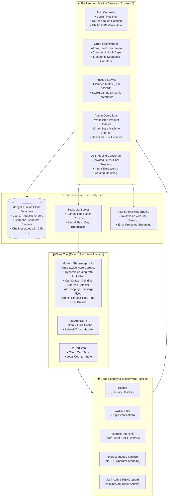
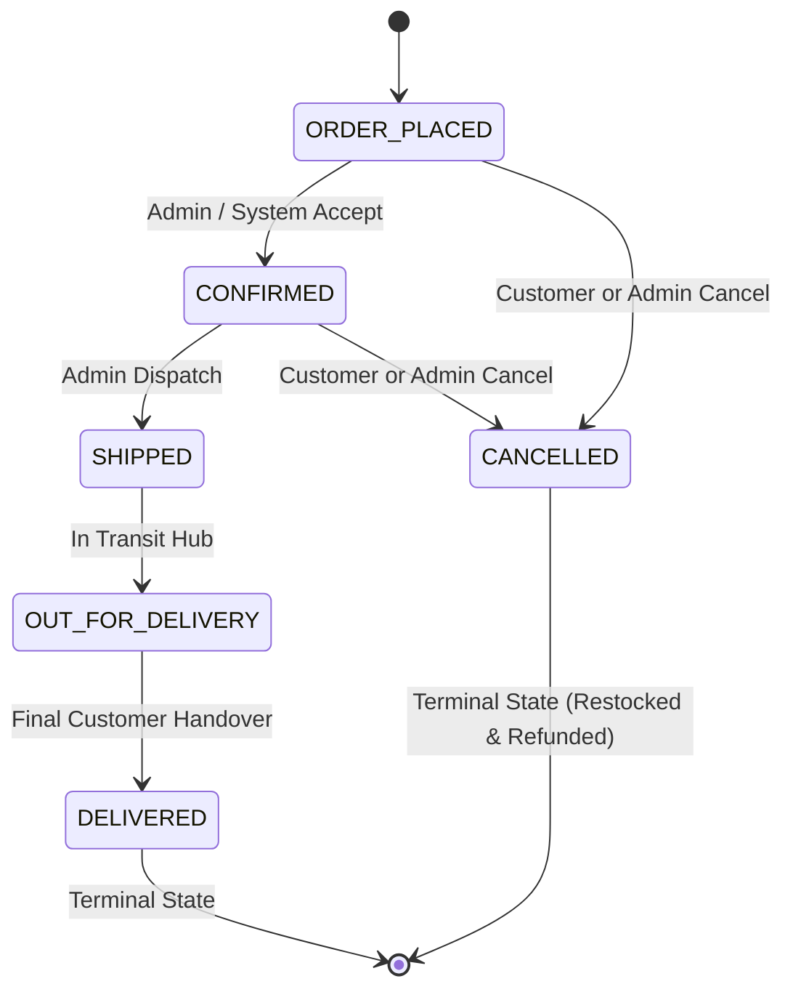

# E-Shop — As-Built Technical Architecture & System Specifications

> **Production System Blueprint, Micro-Flows, State Machines & Security Topologies**  
> *Audited and hardened according to Staff-Level Engineering Standards.*

---

## 1. Executive System Overview

**E-Shop** is a high-performance full-stack e-commerce web platform engineered with an asynchronous event-driven backend and a responsive glassmorphic frontend.

| Architectural Dimension | Production Specification |
| :--- | :--- |
| **Frontend Framework** | React 19 (SPA) with Vite 6 Build Engine |
| **Styling & UI Theme** | Custom Tailwind CSS v3 with Glassmorphic HSL Design Tokens |
| **Client State Management** | Zustand Global Stores (Auth, Cart, Wishlist, Notifications) |
| **API Server Layer** | Node.js (v24) + Express.js (v4 RESTful API) |
| **Real-time Engine** | Socket.IO v4 (Authenticated WebSockets with Scoped User Rooms) |
| **Database & Persistence** | MongoDB Atlas (M0 Shared Cloud Cluster) via Mongoose 8 ODM |
| **Authentication & Tokens** | Dual-Token JWT (15-min Access Tokens + Rotating 7-day Refresh Tokens in HttpOnly Cookies) |
| **Abuse & Bot Defense** | Helmet Security Headers, Express Rate Limiting, NoSQL Injection Sanitization |
| **Concurrency & Integrity** | Atomic `$gte` Stock Handling, Compensating Rollbacks, Monotonic Counter Sequence |
| **Automated Testing & CI** | Node.js Test Runner + Supertest + GitHub Actions CI Pipeline |

---

## 2. End-to-End Topological Architecture



---

## 3. Data Integrity & Concurrency Architecture

### 3.1. Atomic Stock Management (Zero Overselling)
To prevent race conditions where concurrent checkouts could drive inventory negative:
1. Every order line item executes an atomic conditional update:
   ```javascript
   Product.updateOne(
     { _id: item.productId, stockQuantity: { $gte: item.quantity }, active: true },
     { $inc: { stockQuantity: -item.quantity } }
   );
   ```
2. The orchestrator inspects `modifiedCount`. If any item fails to acquire sufficient stock, all previously decremented units in that checkout execution are compensated via an immediate atomic rollback (`$inc: { stockQuantity: item.quantity }`), and the request is rejected with `409 Conflict`.

### 3.2. Order State Machine
Orders follow a deterministic, finite state lifecycle:

- **Cancellation Restocking**: Transitioning an order to `CANCELLED` atomically returns all item quantities to inventory (`$inc: { stockQuantity: item.quantity }`), restores any applied promo coupon usage count (`$inc: { usedCount: -1 }`), and automatically flags `paymentStatus = 'REFUNDED'` for prepaid orders.
- **Illegal Transitions**: Terminal states cannot be reopened, eliminating status corruption.

### 3.3. Monotonic Sequence Counters
Order numbers (`ORD-YYYYMMDD-XXXXX`) and tax invoices (`ESH-YYYY-XXXXXX`) are generated using an atomic sequence counter (`Counter` collection) with `findOneAndUpdate` and `$inc`, guaranteeing zero collisions even at high transaction concurrency.

---

## 4. Security & Abuse Prevention

### 4.1. Dual-Token Authentication & Rotation
- **Access Tokens**: Short-lived (15 minutes), signed with `JWT_ACCESS_SECRET`.
- **Refresh Tokens**: 7 days TTL, signed with `JWT_REFRESH_SECRET`, stored inside an `httpOnly`, `sameSite: 'lax'`, `secure: production` cookie.
- **Session Revocation**: The `User` model maintains an atomic `tokenVersion`. Calling `POST /api/auth/logout` or resetting a password increments `tokenVersion`, invalidating all active refresh sessions across devices.

### 4.2. Layered Rate Limiting & Input Sanitization
- `helmet`: Sets modern HTTP security headers.
- `express-mongo-sanitize`: Strips dangerous `$` and `.` operators from request bodies, parameters, and query strings.
- Dedicated tiered rate limiters:
  - Global API: 1,000 requests per 15 minutes per IP.
  - Auth Endpoints (`/login`, `/register`, `/forgot-password`): 30 attempts per 15 minutes.
  - AI Shopping Concierge (`/api/ai/chat`): 40 messages per minute.

### 4.3. Isolated Guest AI Sessions
Unauthenticated shoppers receive an unguessable browser-scoped session ID (`guest_<uuid>`). Server-side queries strictly scope history lookups to `{ sessionId, userId: null }`, ensuring no guest ever accesses conversations conducted by other guests. Guest messages automatically expire after 24 hours via MongoDB TTL indexes.

---

## 5. Delivery Intelligence & Dynamic Pricing

Transit times and delivery fees are computed using a Haversine coordinate distance engine based on the primary warehouse hub (PIN `560001` - Bengaluru Central GPO):
- **Dynamic Configuration**: Thresholds are read directly from `StoreSettings` (e.g., `freeShippingMinAmount` and `shippingFee`).
- **Address Change Gate**: Customers can update shipping addresses only while the order is in `ORDER_PLACED` or `CONFIRMED` stages. Updating recalculates the delivery fee, updates `pricing.total`, and updates delivery timeline notes.

---

## 6. Real-Time Communication Architecture

Socket.IO connections are secured via handshake token verification:
- **Private User Channels**: Authenticated clients automatically join `user_${userId}` rooms to receive private order status updates and notifications.
- **Public Broadcasters**: Promotional flash deals are emitted globally without exposing user metadata.

---

## 7. Testing & Operational Verification

- **Automated Test Suite**: Tested using Node.js's native test runner (`node --test`) and Supertest.
- **Continuous Integration**: `.github/workflows/ci.yml` triggers automated installation, build validation, test suite execution, and dependency security audits on every pull request.
- **Operational Probes**: `/api/health` continuously reports uptime and MongoDB connection readiness (`readyState === 1`).
- **Graceful Shutdown**: Intercepts `SIGTERM` and `SIGINT`, closes HTTP listeners, disconnects WebSocket clients, safely terminates Mongoose connection pools, and exits cleanly.
